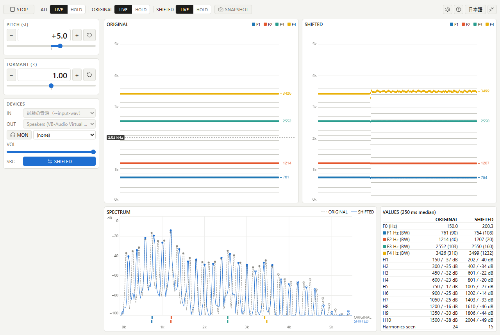

# voice-shift-scope

マイクの声のピッチとフォルマントを別々に変えて出力の機器に流し、変える前と後の F0・F1〜F4・倍音を 1 つの画面に並べて表示する Windows のアプリ。声の研究のために作っている。表示を止めて目標にし、自分の声の出し方を変えながら、目標に近づくかを見比べる使い方を想定している。

## 動く環境

- Windows 10・11 の x64
- Microsoft Edge WebView2 Runtime。Windows 11 には含まれ、Windows 10 の多くの機器にも入っている。起動しないときは https://developer.microsoft.com/microsoft-edge/webview2/ から入れる
- 録音の機器（マイク）と、声を流す再生の機器
- 変えた声を他のアプリにマイクとして渡すときだけ、VB-CABLE（https://vb-audio.com/Cable/ ）などの仮想の音声機器

## 入手と起動

1. https://github.com/kmnk/voice-shift-scope/releases から `voice-shift-scope-<版>-windows-x64.zip` を落とす
2. 好きな場所に展開し、中の `voice-shift-scope.exe` を起動する。インストールはしない

版が `0.` で始まるものは開発版で、試しに使ってもらうためのもの。

落としたファイルが壊れていないかは、release の `SHA256SUMS.txt` の値と、PowerShell の `Get-FileHash <zip のパス>` の値が同じかで確かめられる。

設定（選んだ機器、言葉、表示、ピッチとフォルマントの値など）は `%APPDATA%\dev.kmnk.voice-shift-scope\preferences.json` に残る。使うのをやめるときは、展開したフォルダーとこのフォルダーを消す。

## 落とすときと起動するときに出る警告

今の配布物には、コードの署名が無い。そのため次が出る。

- ブラウザーで落とすとき、よく落とされているファイルではないという警告が出ることがある。ブラウザーの表示に従って保存を続ける
- 起動するとき、「Windows によって PC が保護されました」という画面が出ることがある。「詳細情報」を押してから「実行」を押すと起動する
- Windows 11 の Smart App Control が有効な PC では、署名の無いアプリは止められて起動できない。Smart App Control を切ると起動できるが、切った後に元に戻せないことがあるので、切るかどうかは各自で判断してほしい

署名は、下の「Code signing policy」のとおり準備している。

## 使い方

1. 左の列の `IN` に入力（マイク）、`OUT` に出力（声を流す先）を選ぶ
2. 上の帯の `START` を押す
3. `PITCH` と `FORMANT` で声を変え、図と数値で変える前と後を見比べる。`ORIGINAL`・`SHIFTED` の切り替えで表示を止め、`SNAPSHOT` で止めた画面を PNG に保存する

キー操作は、上の帯の `?` のボタンで一覧を開ける。

## 声を他のアプリの入力に渡すとき

`OUT` には、スピーカーやヘッドホンなど、どの再生の機器も選べる。変えた声を通話や録音のアプリにマイクとして渡したいときは、VB-CABLE（https://vb-audio.com/Cable/ ）などの仮想の音声の機器を入れて、`OUT` にその再生側（VB-CABLE なら `CABLE Input`）を選び、渡す先のアプリのマイクに録音側（`CABLE Output`）を選ぶ。VB-CABLE が入っていれば、`OUT` をまだ選んだことが無いとき、アプリはそれを選んでおく（選んだ `OUT` は次の起動でも残る）。

`OUT` とモニター（`MON`）に流す音は、`SRC` で変えた声（`SHIFTED`）と元の声（`ORIGINAL`）を切り替えられる。

## ネットへの通信

アプリは、ネットに何も送らず、何も受け取らない。マイクの音は手元の PC の中で変えて、選んだ機器に流すだけで、記録もしない。設定は上の `preferences.json` に、保存した画像は選んだフォルダーに、手元にだけ置く。

## Code signing policy

Windows の配布物のコードの署名を、SignPath Foundation（https://signpath.org/ ）に申し込む準備をしている。署名が付くまでは、上の警告が出る。

- 署名するもの: このリポジトリの `.github/workflows/release.yml` が GitHub Actions で build した `voice-shift-scope.exe` と `voice-cli.exe` だけ。何を署名するかは `.signpath/artifact-configuration.xml` にある
- 役割: 作者・レビュアー・承認者は、すべて kmnk（https://github.com/kmnk ）
- プライバシー: 上の「ネットへの通信」のとおり、アプリは利用者の情報を集めず、送らない

## 開発

build と試験の方法は [AGENTS.md](AGENTS.md) に、試験の判定の名前と合格の条件は [docs/criteria.md](docs/criteria.md) にある。開発で確かめるための道具 `voice-cli.exe` も、release に別の zip で置いている。

## ライセンス

MIT License（[LICENSE-MIT](LICENSE-MIT)）と Apache License 2.0（[LICENSE-APACHE](LICENSE-APACHE)）の、どちらかを選んで使える。

配布物には、使っている第三者のソフトウェアのライセンスの文を `THIRD-PARTY-LICENSES.txt` として入れている。`third_party/` の Signalsmith Stretch と Signalsmith Linear は MIT License。
